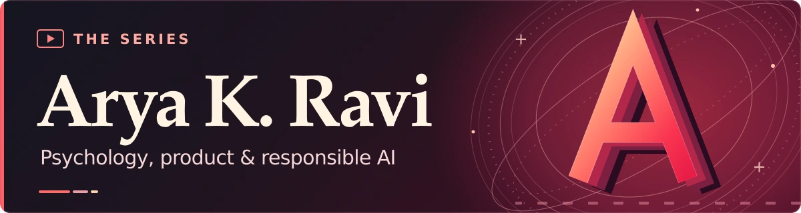

**Open to Associate Product Manager and Program Manager roles** in Bengaluru or on remote teams.

I’m **Arya K. Ravi**, a former Technical Program Manager with an MSc in Psychology. I’m pursuing an MBA in AI for Business at BITS Pilani. The question that draws me to responsible AI is when a product should make a decision and when it should ask the person using it.

[**Explore my portfolio**](https://akr246.github.io/series/) · [**Product résumé (PDF)**](https://akr246.github.io/resumes/Arya-K-Ravi-Associate-Product-Manager.pdf) · [**Program résumé (PDF)**](https://akr246.github.io/resumes/Arya-K-Ravi-Associate-Program-Manager.pdf) · [**Email me**](mailto:akr24698@gmail.com)

## SpendLens

I wrote the product requirements and built this budgeting prototype for Indian households in React and TypeScript. When its rules can’t confidently classify a purchase, it asks the user to review it. A separate check screens each savings suggestion for cuts to essentials. Select the example below to see the original demo dashboard.

[**Try a sample household**](https://akr246.github.io/spendlens-ai-spend-intelligence/#/app) · [**Read the product case study**](https://akr246.github.io/spendlens-ai-spend-intelligence/#/case-study) · [**Inspect the guardrail code**](https://github.com/Akr246/spendlens-ai-spend-intelligence/blob/main/src/engine/nudges.ts)

## Product analytics and strategy

- **[Product Analytics Dashboard](https://akr246.github.io/series/lab/product-analytics/)** — Run the sample to see how conversion is calculated. Three people viewed the product and one also made a purchase, giving 33.3% viewer-to-buyer conversion. It’s one of [50 browser-based prototypes in Project Lab](https://akr246.github.io/series/lab/).
- **[LEGO customer lifecycle strategy (PDF)](https://akr246.github.io/series/assets/lego-strategy.pdf)** — For this MBA case study, I proposed a loyalty programme that changes as builders grow and a two-market pilot to test it.

## Experience

- **CHRIST (Deemed to be University)** — I coordinate academic workflows and support programme data quality and reporting in Bengaluru.
- **Align Technē** — As a Technical Program Manager, I scoped requirements for an AI workflow prototype and coordinated delivery across distributed teams.
- **Annalect India (Omnicom)** — I used SQL and Tableau to investigate onboarding friction and prioritise improvements.

I also have experience in AI data evaluation and annotation with TELUS International and Alignerr, and in customer-facing product work at Think & Learn.

**Tools I use** include SQL, Python, Tableau, Salesforce, Jira, React and TypeScript. [LinkedIn](https://www.linkedin.com/in/akr246/) · [Credentials on Credly](https://www.credly.com/users/arya-k-ravi)

Additional role-specific résumés (PDF)

[Product Associate](https://akr246.github.io/resumes/Arya-K-Ravi-Product-Associate.pdf) · [Product Analyst](https://akr246.github.io/resumes/Arya-K-Ravi-Product-Analyst.pdf) · [Business Analyst](https://akr246.github.io/resumes/Arya-K-Ravi-Business-Analyst.pdf)

